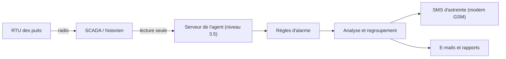

# Agent de surveillance des puits

Prototype d'un agent qui surveille des puits pétroliers jour et nuit : il lit les données de télémétrie, détecte les anomalies, trouve la cause probable, prévient l'astreinte par SMS et envoie les rapports par e-mail.

> **Prototype indépendant.** Toutes les données sont fictives. Il n'y a aucune connexion à un SCADA ou à un équipement réel. L'agent est conçu pour rester en **lecture seule** : il ne commande aucune vanne et ne remplace ni les alarmes SCADA ni les systèmes de sécurité.

**[Ouvrir la démonstration en ligne](https://VOTRE-NOM.github.io/agent-surveillance-puits/)**, puis appuyer sur « Lancer la démo guidée » (environ une minute).

<!-- Ajoutez vos captures d'écran dans docs/img/, puis retirez les marques de commentaire :


-->

## Pourquoi

La nuit, un puits qui s'arrête, une RTU qui perd la radio ou une pression annulaire qui monte peuvent n'être vus que le matin. La télémétrie par radio arrive déjà au SCADA : l'agent la surveille en continu, l'analyse comme le ferait un ingénieur de production, et ne réveille que la bonne personne.

## Ce que montre la démonstration

- **12 puits, 3 manifolds, 3 répéteurs radio**, avec trois types de puits : gas lift, éruptifs, éruptifs avec eau de dessalage.
- **16 types d'incidents** : chute ou hausse de pression, arrêt du gas lift ou de l'eau de dessalage, pression annulaire, instabilité, capteur défaillant, batterie faible, perte radio, vanne de sécurité fermée, détection feu, intrusion, défaut de carte E/S, panne de répéteur, panne du réseau gas lift, restriction de collecte.
- **Regroupement cause et conséquence** : quatre puits muets en même temps donnent un seul SMS « répéteur en panne », pas quatre.
- **Escalade par SMS** avec acquittement (« OK »), sur une liste d'astreinte configurable. Un signal feu prévient tout le monde en même temps.
- **Déclin de pression sur un an** : retire les fermetures, lavages et changements de duse, compare 7, 30, 60 jours et un an, distingue un déclin de zone d'un déclin propre au puits, repère une dérive de capteur, estime quand le puits ne débitera plus.
- **Production différée** en m³ et en dollars, comptée minute par minute.
- **Performance du système d'alarmes** comparée aux références EEMUA 191 et ISA 18.2 : taux d'alarmes, pics, inondations, alarmes persistantes et bavardes, avec et sans l'agent.
- **Rapports** : journalier, relève de quart, déclin, bilan des alarmes.

L'analyse rédigée par un modèle d'IA n'est active que lorsque la page est ouverte dans Claude. Sur GitHub, toute l'analyse vient de règles fixes.

## Principes de conception

1. **Lecture seule.** L'agent lit le SCADA ou son historique. Il ne parle jamais directement aux RTU et n'envoie aucune commande.
2. **Les alarmes viennent de règles fixes**, prévisibles et vérifiables. L'IA, quand elle est utilisée, sert à expliquer et à rédiger, jamais à décider d'une urgence.
3. **Une alarme, une cause.** Les alarmes secondaires sont rattachées à la cause déjà signalée (suppression par conception, ISA 18.2).
4. **Les données restent en local** : serveur sur site, passerelle SMS par modem GSM.
5. **L'humain garde la main** sur toute manœuvre.

## Architecture visée



La connexion se ferait côté lecture seule, dans une zone intermédiaire entre le réseau bureautique et le réseau de contrôle, selon le modèle Purdue et l'approche par zones et conduits de l'IEC 62443.

## Passerelle SMS pour la démonstration

`passerelle-sms.py` sert la page en local et transmet les SMS d'urgence à un téléphone Android qui fait office de passerelle (application « SMS Gateway for Android », mode Local Server). Aucune bibliothèque à installer.

```
python passerelle-sms.py --test
python passerelle-sms.py --phone 192.168.1.25 --user LOGIN --password MOTDEPASSE
```

Puis ouvrir `http://localhost:8787`, et dans l'onglet Paramètres cocher l'envoi de vrais SMS. Un téléphone personnel n'est adapté qu'à une démonstration : un système réel utiliserait un modem GSM dédié.

## Feuille de route

1. **Pilote de 3 mois sur 5 puits**, en parallèle du système actuel, avec accès en lecture seule (OPC UA ou base de données).
2. Stockage de l'historique dans une base de séries temporelles.
3. Seuils définis avec les ingénieurs de production, puis mesure des fausses alarmes.
4. Modem GSM dédié et compte e-mail de service.
5. Analyse par IA locale ou approuvée, pour les explications et les rapports.

## Limites

- Les données sont simulées ; la scrutation radio est simplifiée à une mesure par minute.
- Les seuils et les valeurs de MAASP sont des exemples, à fixer avec les équipes du site.
- Ce n'est pas un système de sécurité et il n'est pas certifié.

## Références

EEMUA 191 et ISA-18.2 (gestion des alarmes), API RP 90 (pression annulaire, MAASP), modèle Purdue et IEC 62443 (cybersécurité industrielle).

## Licence

MIT, voir [LICENSE](LICENSE). Auteur : [Votre nom].

---

## English summary

A prototype **well surveillance agent** for oil fields with radio telemetry. It watches wells 24/7, detects anomalies, groups related alarms under their root cause, sends SMS escalations to the on-call roster, forecasts long-term pressure decline, tracks deferred production, and benchmarks its alarm load against EEMUA 191 / ISA-18.2. Everything runs on simulated data in a single HTML file (no build step). The design is strictly read-only: it never commands equipment. Open the live demo and press "Lancer la démo guidée".
