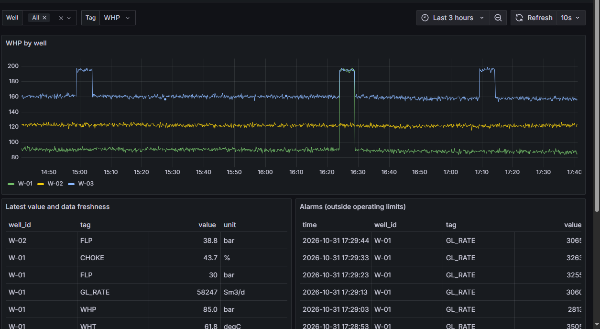
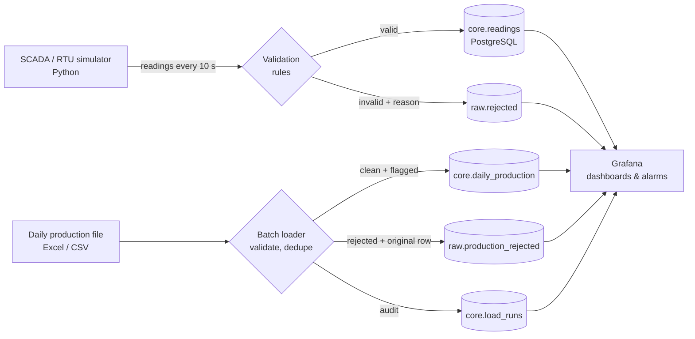

# Well Data Platform

An end-to-end data and infrastructure platform for oil-well telemetry: SCADA-style data is
ingested, validated, stored in PostgreSQL, monitored in Grafana, and (in later milestones)
deployed on a cloud Linux server with automated backups and CI/CD.

It is built around one question operations teams ask every day: **can we trust the well data
we are looking at, and will we know quickly when something goes wrong?**

> Telemetry is simulated: wells, values and limits are fictional. The batch loader is built for the
> public Equinor Volve production dataset (not included in this repo; see below).



## Architecture



| Component | What it does |
|---|---|
| `simulator/` | Produces readings for 3 wells and 5 tags (WHP, WHT, FLP, choke, gas-lift rate) with drift, a daily cycle and noise. Injects real-world data faults (spikes, NaN, negative pressure, unknown tags) and operational events (pressure build-up, gas-lift supply loss). |
| `simulator/validation.py` | Rejects readings that are physically impossible, malformed or from unknown wells or tags. Rejected readings are stored with a reason and never silently dropped. |
| `db/init/` | Schema: well master data, a sensor catalog with physical and operating limits, the time-series table, a quarantine table, views for data freshness and alarms. |
| `loader/` | Batch job that loads daily production files (Volve "Daily Production Data" format, Excel or CSV). Every row is loaded, flagged or rejected with a reason and its source line. Re-running the same file is a no-op (file fingerprint + upsert). Every run is recorded in `core.load_runs`. |
| `grafana/` | Provisioned data source and dashboard: trends, data freshness, alarms, rejection rate and reasons. |
| `.github/workflows/ci.yml` | Unit tests, schema applied to a real PostgreSQL, a simulator run, data checks and a Docker build on every push. |

### Design decisions

- **Two kinds of limits per sensor.** *Physical* limits separate bad data from real data. *Operating* limits raise alarms. A wellhead pressure of 4,750 bar is a broken sensor; 195 bar is a real alarm.
- **Quarantine, don't delete.** Invalid readings go to `raw.rejected` with the reason, so data-quality problems can be measured and traced back to their source.
- **Least privilege.** The simulator's database role can only insert telemetry. Grafana's role can only read. Neither can delete or change anything.
- **Network exposure.** Ports are bound to `127.0.0.1`, so the database and Grafana are not reachable from the network.
- **No secrets in Git.** All passwords come from `.env`, which is ignored by Git.
- **Three outcomes per production row: loaded, flagged, rejected.** Impossible values (negative volumes, a choke above 100 %) are rejected. Possible but suspicious values (oil reported with 0 hours on stream) are kept and flagged for a human, because deleting them would hide a real reporting problem.
- **Idempotent batch loads.** The file's SHA-256 fingerprint is recorded; loading the same file twice does nothing, and `--force` re-loads it safely with an upsert, so a retried job never duplicates data.
- **Lineage.** Every production row points to the load run that wrote it, and every rejected row keeps its original values and source line number.
- **BRIN index on time.** Telemetry arrives in time order, so a BRIN index gives fast time-range queries at a fraction of a B-tree's size.

## Quick start

Requirements: [Docker Desktop](https://www.docker.com/products/docker-desktop/) (Windows, macOS) or Docker Engine (Linux).

```bash
git clone https://github.com/Djaafar-ar/well-data-platform.git
cd well-data-platform
cp .env.example .env          # Windows PowerShell: copy .env.example .env
# edit .env and change every password
docker compose up -d --build
```

Open http://localhost:3000, log in as `admin` with the password from `.env`, then open **Wells → Well Overview**.
The simulator first writes 6 hours of history, then sends live data every 10 seconds.

Useful commands:

```bash
docker compose ps                                   # is everything running?
docker compose logs -f simulator                    # watch readings arrive
docker compose exec db psql -U wells_admin -d wells # SQL shell
docker compose stop simulator                       # simulate a communication loss
docker compose down                                 # stop (data is kept)
docker compose down -v                              # stop and delete all data
```

## Loading production data

Try it with the synthetic sample (fictional wells, Volve column format, with deliberate errors):

```bash
docker compose run --rm loader /fixtures/sample_production.csv
```

Expected: `1461 rows read, 1455 loaded (1 flagged), 6 rejected`, with one line per rejection reason.
Run it again: it is skipped, because that exact file was already loaded.
Then open **Wells → Field Production** in Grafana.

With the real Volve data: Equinor publishes the Volve field dataset under the Equinor Open Data Licence
(see [Volve data sharing](https://www.equinor.com/en/energy/volve-data-sharing)). Put the production
workbook in `data/` (ignored by Git, so the data is never committed) and run:

```bash
docker compose run --rm loader "/data/Volve production data.xlsx"
```

The loader picks the daily sheet automatically. Use `--sheet "<name>"` to choose another one.

## SQL practice

`sql/practice.sql` has seven exercises on this data, from simple aggregates to window functions
and "gaps and islands". Answers are in `sql/practice_answers.sql`.

## Tests

```bash
pip install -r simulator/requirements.txt pytest
pytest -q
```

## Roadmap

- [x] **M1 – Local stack:** simulator, validation, PostgreSQL schema, Grafana dashboard, CI
- [x] **M2 – Batch ingestion:** production files (Volve format) with validation, flags, rejects, lineage and idempotent reloads
- [ ] **M3 – Well logs and catalog:** ingest LAS well logs; metadata catalog (well, source, units, lineage)
- [ ] **M4 – Alerting:** Grafana alert rules and email notifications; data-freshness alerts
- [ ] **M5 – Cloud deployment:** Linux VM on Azure, firewall rules, HTTPS reverse proxy, nightly backups with a tested restore
- [ ] **M6 – Automation:** deploy from GitHub Actions; runbook for operations

## License

MIT
